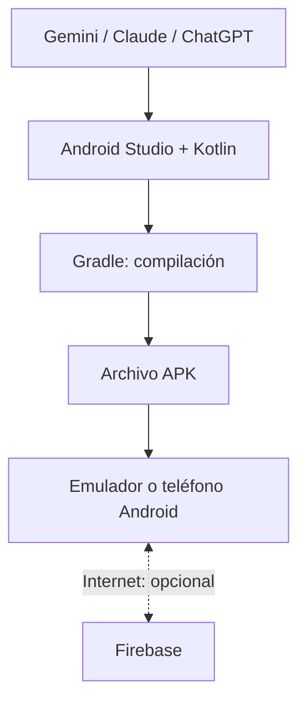

# Actividad 01. Desarrollo de una aplicación Android completa

**Módulo:** Entornos de Desarrollo · 1.º DAW  
**Referencias pedagógicas:** RA1, RA2 y RA3  
**Fecha:** 26/11/2026 · Versión 1.0.0

[Volver al índice de actividades](README.md)

## 1. Objetivo

Desarrollar una aplicación Android funcional, comprender el proceso de desarrollo de software y generar un archivo APK instalable en un teléfono real.

## 2. Herramientas

- [Android Studio](https://developer.android.com/studio): IDE, compilación, emulador y depuración.
- Kotlin: lenguaje propuesto.
- IA: Gemini, Claude o ChatGPT, como asistentes de programación.
- [Firebase](https://firebase.google.com/): almacenamiento en la nube opcional.

## 3. Funcionalidad: elige una opción

| Opción | Requisitos mínimos |
|---|---|
| Calculadora sencilla | Dos números, suma, resta, multiplicación, división y control de división entre cero. |
| Agenda de notas | Crear, consultar, modificar y eliminar notas; conservarlas tras cerrar la aplicación. |
| Aplicación libre | Resolver una necesidad concreta con una interfaz sencilla y funcionalidad comprobable. Describe previamente sus requisitos. |

Ejemplos de aplicación libre: conversor de unidades, lista de tareas o contador de hábitos.

## 4. Arquitectura

La IA ayuda durante el desarrollo; no es necesario incorporarla a la aplicación. Firebase es opcional y no se requiere para una calculadora. Para la agenda se puede usar almacenamiento local.

## 5. Fases de desarrollo

1. **Análisis:** define el objetivo, el usuario y al menos tres requisitos funcionales.
2. **Diseño:** dibuja un boceto de la interfaz y describe los controles.
3. **Proyecto:** crea un proyecto Android Studio de tipo Empty Activity con Kotlin; elige un nombre y un identificador de paquete propios.
4. **Programación:** implementa las funcionalidades progresivamente con ayuda de la IA. Lee y comprende el código antes de incorporarlo.
5. **Compilación:** sincroniza Gradle y corrige los errores. Documenta al menos un problema y cómo lo resolviste.
6. **Pruebas:** ejecuta la aplicación en un emulador o dispositivo y registra los resultados.
7. **APK:** utiliza la opción de generación de APK del menú Build (su nombre puede variar según la versión), o ejecuta `./gradlew assembleDebug` en Linux/macOS o `gradlew.bat assembleDebug` en Windows desde la raíz del proyecto. Habitualmente encontrarás el APK en `app/build/outputs/apk/debug/app-debug.apk`.
8. **Instalación:** prueba el APK en un teléfono Android propio o autorizado. Si se necesita autorizar la instalación desde esa fuente, hazlo únicamente para tu APK y revoca el permiso después. El APK de depuración es suficiente para esta práctica; no es una publicación comercial.

## 6. Uso de la inteligencia artificial

Ejemplos de prompts:
- «Explícame cómo crear una calculadora sencilla en Kotlin con Jetpack Compose, paso a paso».
- «Explícame este error de Gradle y cómo resolverlo sin cambiar archivos innecesarios».
- «Propón pruebas para verificar que mi aplicación funciona correctamente».

Conserva ejemplos de los prompts, explica qué cambios has realizado y qué código comprendes. No compartas contraseñas, claves privadas ni datos personales.

## 7. Pruebas

Completa una tabla como esta con resultados reales:

| Prueba | Resultado esperado | Resultado obtenido | Correcto |
|---|---|---|---|
| Inicio de la aplicación | Abre sin errores | | |
| Función principal | Resuelve la operación prevista | | |
| Entrada incorrecta | Gestiona el error sin cerrarse | | |
| Reinicio | Se inicia correctamente; conserva datos si corresponde | | |

## 8. Ampliación opcional: Firebase

Si la aplicación utiliza datos, puedes crear un proyecto Firebase, registrar la app Android y conectar Cloud Firestore siguiendo la documentación oficial. Configura autenticación y reglas de acceso adecuadas; no dejes una base de datos pública ni introduzcas datos personales reales. Comprueba la lectura y escritura desde la aplicación. Esta ampliación no es obligatoria.

## 9. Entrega

- Código fuente del proyecto (sin cachés de compilación ni secretos).
- Archivo APK.
- Capturas de pantalla de la aplicación funcionando.
- Breve explicación de requisitos, diseño, funcionamiento y proceso de compilación.
- Ejemplos de prompts utilizados y tabla de pruebas.

## 10. Evaluación propuesta

| Criterio | Puntos |
|---|---:|
| Funcionalidad de la aplicación | 3 |
| Uso del IDE, compilación y APK instalable | 2 |
| Interfaz y diseño | 1 |
| Comprensión y explicación del código | 2 |
| Pruebas y resolución de errores | 1 |
| Documentación y uso razonado de IA | 1 |
| **Total** | **10** |

**Recuerda:** el objetivo no es únicamente generar una aplicación con IA, sino comprender todo el proceso de desarrollo, desde la idea hasta su instalación.
