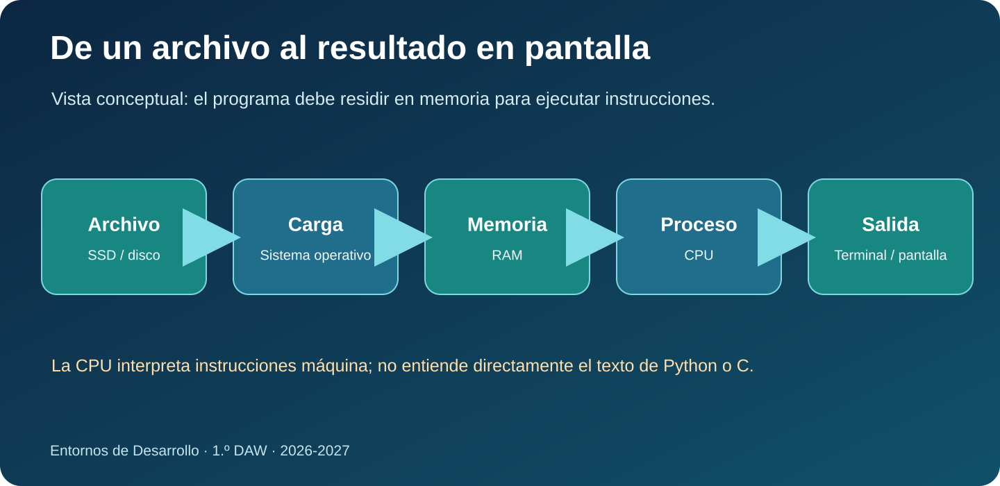
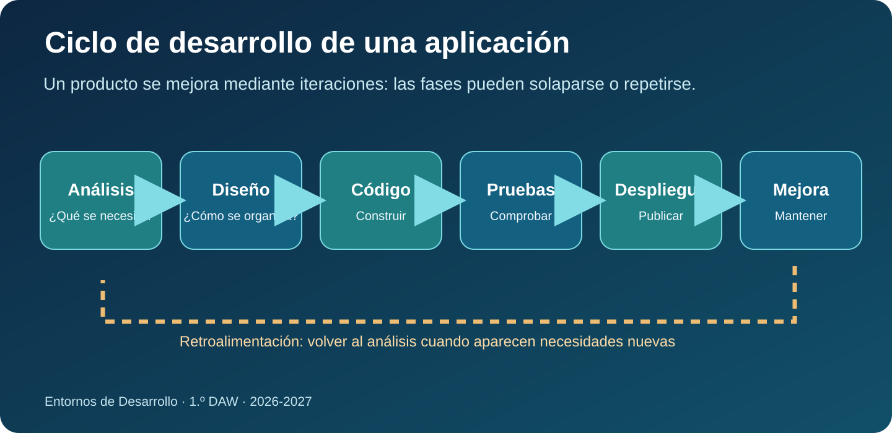
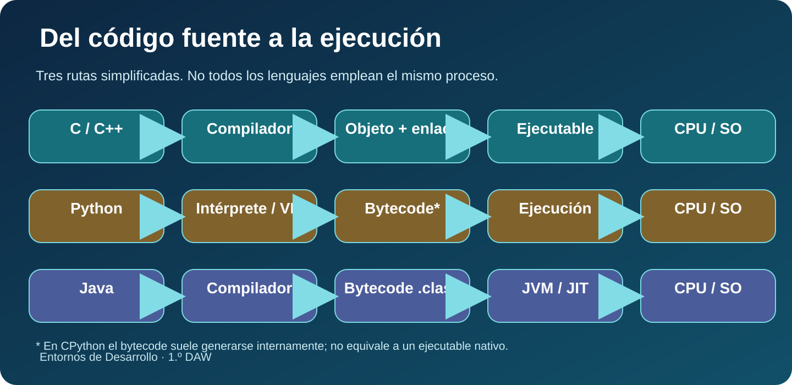
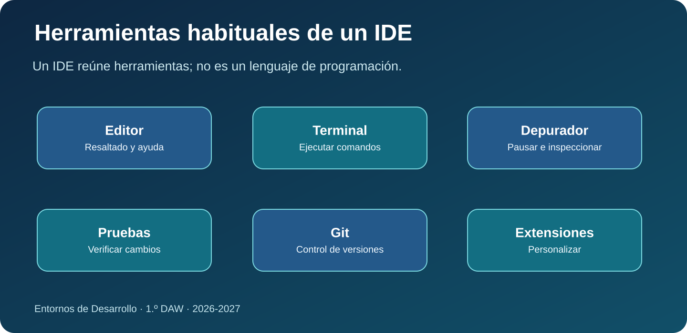

# Tema 1. Introducción al desarrollo de software

**Materia:** Entornos de Desarrollo · 1.º DAW · curso genérico de Formación Profesional  
**Resultados de aprendizaje:** RA1, criterios a–g · introducción a RA2  
**Estado:** Versión inicial para revisión en el aula

[Volver al índice general](../../README.md)

## Materiales del tema

- [Presentación HTML — abrir en el navegador](https://htmlpreview.github.io/?https://github.com/bitschips/entornos_dev/blob/main/temas/tema-01-introduccion-al-desarrollo-de-software/presentaciones/tema-01.html)
- [Presentación PPTX — descargar](presentaciones/tema-01-introduccion-al-desarrollo-de-software.pptx)

## Objetivos de aprendizaje

Al acabar el tema, el alumnado podrá:

- Describir qué es un programa y cómo se relaciona con CPU, memoria, almacenamiento y periféricos (RA1.a).
- Explicar las fases principales de desarrollo de una aplicación (RA1.b).
- Diferenciar código fuente, código objeto, ejecutable y código intermedio (RA1.c y RA1.d).
- Comparar compilación, interpretación y ejecución en máquina virtual sin confundirlas (RA1.c–e).
- Reconocer diferentes paradigmas y herramientas de programación (RA1.e–f).
- Identificar cuándo resulta útil trabajar de forma iterativa y aplicar prácticas ágiles sencillas (RA1.g).

## 1. ¿Qué es desarrollar software?

Un **programa informático** es un conjunto organizado de instrucciones y datos que un sistema puede ejecutar para realizar una tarea. Una **aplicación** suele integrar uno o varios programas, recursos y configuración para resolver necesidades de una persona o empresa.

**Desarrollar software** no es solo escribir instrucciones. Significa **comprender un problema, diseñar una solución, implementarla, comprobar su funcionamiento, distribuirla y mantenerla**.

**Ejemplo DAW:** una web de reservas de pistas deportivas necesita interfaz, lógica que compruebe horarios, almacenamiento de reservas y pruebas para evitar duplicidades.

| Concepto | Qué significa | Ejemplo |
|---|---|---|
| Programa | Instrucciones y datos organizados | Script que calcula el IVA |
| Aplicación | Producto que ofrece funciones al usuario | Gestor web de reservas |
| Algoritmo | Pasos finitos y definidos para resolver un problema | Ordenar precios |
| Lenguaje | Reglas para expresar un programa | Python, Java, JavaScript, C |
| Herramienta | Software que ayuda a construir o probar programas | Editor, compilador, depurador |

## 2. ¿Cómo se ejecuta un programa en un ordenador?

La **CPU** ejecuta instrucciones de su arquitectura de máquina. La **RAM** mantiene temporalmente las instrucciones y datos en uso. El **almacenamiento** conserva programas y archivos entre arranques. Los **periféricos** permiten introducir y presentar información. El **sistema operativo** gestiona procesos, memoria, archivos y dispositivos.

**Secuencia conceptual:**

1. El programa está almacenado como archivo, o se recibe desde un servicio.
2. El sistema prepara un **proceso** y dispone el código y los datos necesarios en memoria.
3. La CPU ejecuta instrucciones máquina; el sistema operativo ofrece servicios de entrada/salida.
4. Se producen resultados: texto, archivos, imagen o respuesta de red.

No confundir **el archivo que contiene el programa** con **el proceso en ejecución**. Tampoco hay que suponer que la CPU ejecuta directamente el código fuente escrito por un programador.

<!-- IMAGEN: img/programa-memoria-cpu.svg | TITULO: Del archivo a la CPU y la pantalla | POSICION: DESPUES -->

## 3. Fases de desarrollo de una aplicación

Una forma sencilla de organizar el trabajo es distinguir estas fases. En proyectos modernos suelen **repetirse en ciclos**, no siempre en orden rígido.

| Fase | Pregunta principal | Producto o evidencia |
|---|---|---|
| Análisis de requisitos | ¿Qué necesita el usuario? | Historias de usuario, requisitos |
| Diseño | ¿Qué componentes tendrá? | Bocetos, diagramas, modelo de datos |
| Implementación | ¿Cómo se programa? | Código fuente y configuración |
| Pruebas | ¿Cumple lo esperado? | Casos, resultados, incidencias |
| Despliegue | ¿Cómo se entrega? | Aplicación publicada, versión |
| Mantenimiento | ¿Qué corregimos o mejoramos? | Correcciones y nuevas versiones |

**Ejemplo:** antes de programar un formulario de matrícula, determinar campos obligatorios, validar una fecha, decidir dónde se guardará la información y qué respuesta recibirá el usuario si faltan datos.

<!-- IMAGEN: img/ciclo-vida-desarrollo.svg | TITULO: Ciclo de vida de una aplicación | POSICION: DESPUES -->

## 4. Código fuente, objeto, ejecutable e intermedio

**Código fuente:** texto escrito en un lenguaje de programación y destinado a ser procesado por un entorno o herramienta. **Código objeto:** salida intermedia habitual de un compilador, especialmente en lenguajes como C; contiene código y referencias que pueden necesitar un **enlazador**. **Ejecutable nativo:** archivo o conjunto preparado para arrancar un programa en una plataforma determinada.

El **código intermedio** es una representación diseñada para otra fase de ejecución, por ejemplo el **bytecode de Java**, que utiliza una máquina virtual. *No se debe equiparar todo código intermedio con código objeto ni con un ejecutable nativo.*

| Ruta | Ejemplo simplificado | Resultado característico |
|---|---|---|
| Compilación nativa | C → compilador → objeto → enlazador | Ejecutable para la plataforma objetivo |
| Interpretación / ejecución gestionada | Python → intérprete / máquina virtual | Ejecución administrada por un entorno |
| Máquina virtual de lenguaje | Java → compilador → bytecode → JVM | Código intermedio portable para JVM |

**Importante:** «compilado» e «interpretado» no son etiquetas exclusivas de los lenguajes. Dependen también de la implementación, el entorno y posibles compiladores JIT. CPython suele convertir el fuente a bytecode antes de ejecutarlo en su máquina virtual.

<!-- IMAGEN: img/rutas-ejecucion.svg | TITULO: Tres rutas de ejecución: C, Python y Java | POSICION: DESPUES -->

### 4.1. Ejemplo de compilación en C

Programa fuente guardado en el archivo **hola.c**:

~~~c
#include <stdio.h>

int main(void) {
    puts("Hola, mundo");
    return 0;
}
~~~

En un sistema con GCC instalado, se puede distinguir la obtención de objeto y el enlace:

~~~bash
gcc -c hola.c -o hola.o
gcc hola.o -o hola
./hola
~~~

En Windows el nombre y la ejecución del archivo final cambian según el compilador; no usar la forma Linux sin adaptarla. El comando **gcc hola.c -o hola** suele hacer compilación y enlace en una sola orden.

### 4.2. Ejemplo de ejecución en Python

Archivo **hola.py**:

~~~python
print("Hola, mundo")
~~~

En Linux puede ejecutarse con **python3 hola.py**; en algunos equipos Windows se usa **py hola.py**. Ejecutar el archivo no implica que se haya creado automáticamente un ejecutable nativo independiente.

## 5. Lenguajes de programación y paradigmas

Un **lenguaje de programación** ofrece reglas de sintaxis y semántica para expresar algoritmos. Los lenguajes se diferencian por sus características, no por una única clasificación en «mejores» o «peores».

- **Imperativo / procedimental:** pasos y cambios de estado (C o partes de Python).
- **Orientado a objetos:** objetos, atributos y métodos (Java, C#, Python).
- **Funcional:** funciones y transformación de datos (Haskell, funciones de JavaScript y Python).
- **Declarativo:** describir qué resultado se busca más que el procedimiento (por ejemplo, consultas SQL).

Un lenguaje puede admitir **varios paradigmas**. No confundir **lenguaje** (Python), **editor/IDE** (VS Code) y **runtime** (intérprete de Python).

| Lenguaje | Uso frecuente | Rasgo ilustrativo |
|---|---|---|
| JavaScript | Interfaz y lógica web | Ejecutado por motores de JS en navegador o servidor |
| Python | Automatización, prototipos, datos | Sintaxis breve, múltiples implementaciones |
| Java | Aplicaciones empresariales | Bytecode y ecosistema JVM |
| C | Sistemas y bibliotecas | Compilación nativa y control de recursos |
| PHP | Backend web | Ejecución en servidor |

## 6. Herramientas de un entorno de desarrollo

- **Editor de código:** escribir, modificar y localizar errores sintácticos.
- **IDE:** reúne edición y herramientas como ejecución, depuración, gestión de proyectos y extensiones.
- **Compilador / intérprete / runtime:** procesar o ejecutar código según la tecnología.
- **Terminal:** lanzar comandos, consultar resultados y automatizar tareas.
- **Depurador:** detener la ejecución, inspeccionar variables y seguir instrucciones.
- **Control de versiones:** registrar cambios en un proyecto; Git es un ejemplo.
- **Pruebas y analizadores:** detectar defectos y verificar comportamientos.

Un **IDE no sustituye al lenguaje de programación** ni al sistema que ejecuta el programa. Dos IDE distintos pueden trabajar con el mismo lenguaje y herramientas.

<!-- IMAGEN: img/herramientas-ide.svg | TITULO: Componentes habituales de un IDE | POSICION: DESPUES -->

## 7. Introducción a métodos de trabajo ágiles

Un proyecto **en cascada** suele organizar etapas con entregas secuenciales. Un enfoque **ágil** favorece entregas pequeñas, revisión frecuente y adaptación de prioridades. Ningún modelo es adecuado automáticamente para todos los contextos.

**Ejemplo de iteración de una web de reservas:**

1. Construir una versión que solo muestre horarios.
2. Recibir comentarios de usuarios.
3. Añadir reserva con validación.
4. Probar conflictos de horario.
5. Planificar la siguiente mejora.

**Scrum** define responsabilidades y eventos de trabajo iterativo; **Kanban** permite visualizar y limitar tareas en curso. Un tablero sencillo puede usar columnas: **Pendiente → En curso → En revisión → Terminado**. Una iteración incluye análisis, código y pruebas, no solo programación.

## 8. Caso integrador: de una necesidad al «Hola, mundo»

**Necesidad:** demostrar que tenemos el entorno listo para construir programas. **Análisis:** debe mostrar un mensaje. **Diseño:** entrada ninguna; salida una línea de texto. **Implementación:** un archivo con una instrucción. **Pruebas:** ejecutar y comparar la salida con el mensaje esperado. **Entrega:** guardar archivo fuente y explicación de ejecución.

**Si falla la ejecución**, comprobar ruta actual, nombre del archivo, sintaxis, instalación del intérprete/compilador y mensajes de error antes de cambiar el programa al azar.

El concepto importante no es memorizar una instrucción: es comprender **quién traduce o ejecuta el código, dónde está el programa y cómo se comprueba el resultado**.

## 9. Actividades propuestas

[Abrir el índice de actividades del tema](actividades/README.md)

## 10. Preguntas de repaso

1. ¿Por qué escribir código no equivale a completar el desarrollo de software?
2. ¿En qué se diferencian archivo, proceso, RAM y CPU?
3. ¿Qué productos obtenemos de análisis, diseño y pruebas?
4. ¿Qué diferencia hay entre código objeto y ejecutable?
5. ¿Por qué el bytecode de Java no es directamente el código máquina de la CPU?
6. ¿Puede un lenguaje combinar compilación e interpretación? Explica.
7. ¿Qué herramientas encuentras en un IDE que no ofrece un editor básico?
8. ¿Qué diferencia hay entre entregar software una sola vez y hacerlo por iteraciones?

## 11. Glosario

| Término | Definición breve |
|---|---|
| Requisito | Necesidad o condición que debe satisfacer el producto |
| Código fuente | Instrucciones escritas en un lenguaje |
| Compilador | Herramienta que transforma código a otra representación |
| Enlazador | Combina código objeto y bibliotecas para producir un resultado enlazado |
| Runtime | Componentes necesarios para ejecutar un programa |
| Máquina virtual | Entorno de ejecución que abstrae una máquina o plataforma |
| Depurador | Herramienta para observar y controlar un programa en ejecución |
| Iteración | Ciclo corto de trabajo, entrega y revisión |
| IDE | Entorno integrado que agrupa varias herramientas de desarrollo |

<!-- PRESENTACION:EXCLUIR -->

## Ideas de ampliación (opcionales, fuera de las diapositivas)

- Comparar una máquina virtual de sistema (VirtualBox) con una máquina virtual de lenguaje (JVM).
- Investigar WebAssembly, sus formatos y la ejecución en navegador.
- Comparar «contenedor» Docker, intérprete y máquina virtual: tres conceptos distintos.
- Explorar asistentes de IA para programar con verificación humana, pruebas y atención a la privacidad.
- Consultar propuestas detalladas en [Ampliaciones del tema](ampliaciones/README.md) e [Ideas de vídeos](videos/README.md).

<!-- PRESENTACION:FIN_EXCLUSION -->

---

## Control de versiones

- **Versión del contenido:** 1.0.1
- **Última actualización:** 23/11/2026
- **Estado:** Versión inicial para revisión en el aula
