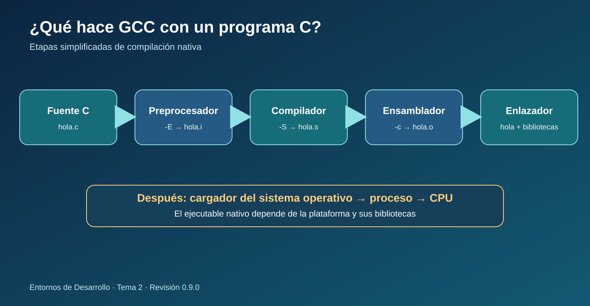
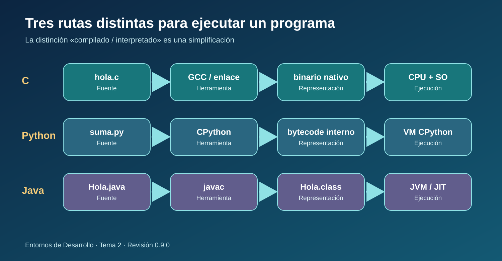
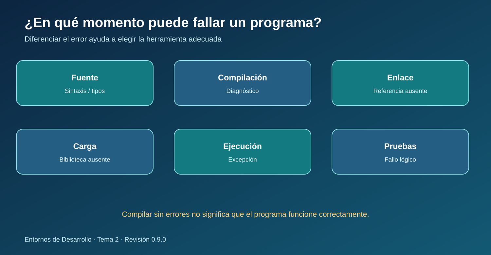

# Tema 2. Lenguajes, compiladores, intérpretes y máquinas virtuales

**Materia:** Entornos de Desarrollo · 1.º DAW · curso genérico de Formación Profesional  
**Resultado de aprendizaje:** RA1 (especialmente criterios c, d, e y f)  
**Estado:** **Borrador completo en revisión**. No es aún el tema oficial para generar presentaciones.  
**Conocimientos previos:** Tema 1 (código fuente, proceso, CPU/RAM y primera ejecución).

[Volver al índice general](../../README.md)

## Materiales del tema

La versión HTML y el PowerPoint se publicarán **después de la aprobación del contenido**. Este archivo es la versión de trabajo; no se enlazan presentaciones inexistentes.

## Objetivos de aprendizaje

Al terminar el tema podrás:

1. Clasificar lenguajes por nivel de abstracción, paradigma y forma habitual de ejecución, sin confundir esos criterios.
2. Explicar qué función cumplen preprocesador, compilador, ensamblador, enlazador y cargador.
3. Distinguir **fuente**, **ensamblador**, **objeto**, **ejecutable nativo** y **bytecode**.
4. Ejecutar y observar las distintas fases de un programa pequeño escrito en C con GCC.
5. Comprender que CPython normalmente compila internamente a bytecode antes de ejecutarlo.
6. Obtener bytecode Java con `javac`, examinarlo con `javap` y ejecutarlo con `java`.
7. Distinguir una máquina virtual de lenguaje, como la JVM, de una máquina virtual que ejecuta un sistema operativo completo.
8. Reconocer errores de sintaxis, compilación, enlace, ejecución y lógica, y asociarlos a la fase adecuada.

## 1. ¿Por qué existen tantos lenguajes de programación?

Los lenguajes permiten expresar instrucciones y datos de un programa. No existe un único lenguaje óptimo para todos los contextos: cambian el propósito, la seguridad de tipos, la facilidad de lectura, las bibliotecas y los entornos de ejecución.

**Ejemplo DAW:** una aplicación web puede combinar **HTML** (marcado, no lenguaje de programación en el mismo sentido), **CSS** (estilos), **JavaScript** (comportamiento del cliente), **Java o Python** (lógica de servidor) y **SQL** (consultas declarativas). Son tecnologías complementarias, no sinónimos.

### 1.1. Tres criterios de clasificación distintos

| Criterio | Categorías ilustrativas | Precaución |
|---|---|---|
| Nivel de abstracción | Código máquina, ensamblador, lenguajes de alto nivel | «Alto nivel» no equivale a «interpretado» |
| Paradigma | Imperativo, funcional, orientado a objetos, declarativo | Un lenguaje puede ser multiparadigma |
| Modelo de implementación | Compilación nativa, bytecode con VM, ejecución interpretada/JIT | No clasifica de forma absoluta a un lenguaje |

**Idea central:** llamar a C «compilado» y a Python «interpretado» sirve como aproximación didáctica; en realidad hay **implementaciones y cadenas de herramientas** que combinan varios mecanismos.

## 2. Código máquina, ensamblador y lenguajes de alto nivel

La **CPU** ejecuta instrucciones codificadas como patrones binarios según su **ISA** (*Instruction Set Architecture*, arquitectura del conjunto de instrucciones), por ejemplo x86-64 o ARM64. Un mismo algoritmo puede necesitar instrucciones distintas según la arquitectura.

El **ensamblador** representa instrucciones máquina mediante nombres simbólicos (*mnemónicos*). Un programa ensamblador transforma esas representaciones y sus datos en código objeto o máquina.

```asm
; Ejemplo conceptual x86, estilo Intel
mov cx, 5
repetir:
    dec cx
    jnz repetir
```

El ejemplo usa registros e instrucciones de x86, pero **no es un programa ejecutable completo**: faltan formato, directivas y salida para un sistema operativo concreto. La instrucción `jnz` salta mientras el resultado anterior no sea cero.

Una versión de alto nivel equivalente en intención es `for i in range(5): ...`. **No existe una correspondencia obligatoria de una línea de alto nivel con una instrucción máquina.**

## 3. Las etapas de una compilación nativa

En un recorrido habitual con C y GCC se pueden distinguir:

1. **Preprocesamiento**: trata directivas como `#include` o `#define`; genera texto fuente preparado.
2. **Compilación**: analiza sintaxis y semántica, realiza transformaciones y puede generar ensamblador.
3. **Ensamblado**: convierte ensamblador en **archivo objeto** para una arquitectura concreta.
4. **Enlazado**: combina objetos y bibliotecas, resuelve referencias y produce un archivo ejecutable o biblioteca.
5. **Carga y ejecución**: el sistema operativo prepara el proceso; bibliotecas dinámicas pueden resolverse al cargar o durante la ejecución.



**Precisión:** GCC es un *controlador* que invoca herramientas de varias fases; «compilar» se utiliza tanto para la fase específica como para todo el proceso. La estructura exacta depende de la plataforma y de las opciones.

### 3.1. Archivo de ejemplo: hola.c

```c
#include <stdio.h>

int main(void) {
    puts("Hola desde C");
    return 0;
}
```

### 3.2. Ejecutar por separado las etapas en Linux

Con GCC instalado, dentro de una carpeta propia:

```bash
gcc --version
gcc -E hola.c -o hola.i
gcc -S hola.c -o hola.s
gcc -c hola.c -o hola.o
gcc hola.o -o hola
./hola
```

| Orden | Resultado | Qué observar |
|---|---|---|
| `-E` | `hola.i` | Texto tras el preprocesador; puede ser extenso por cabeceras |
| `-S` | `hola.s` | Instrucciones ensamblador del destino |
| `-c` | `hola.o` | Objeto binario; aún no es un programa completo ejecutable |
| Sin opción de parada | `hola` | Ejecutable enlazado para el sistema de destino |

**Nota:** los comandos indicados son para **GCC en Linux**. En Windows, MinGW puede generar `.exe` y las herramientas o comandos de ejecución pueden ser distintos. No basta con cambiar la extensión a un archivo para transformarlo en ejecutable.

## 4. El enlazador y las bibliotecas

¿Por qué necesita el programa la función `puts` aunque no aparezca su código fuente en nuestro archivo? Porque la implementación se proporciona por bibliotecas de la plataforma. El proceso de enlace puede resolver referencias a objetos o bibliotecas, mientras que algunas bibliotecas compartidas se cargan dinámicamente más adelante.

- **Enlace estático**: incorpora al resultado código necesario procedente de bibliotecas estáticas, cuando se utiliza.
- **Enlace dinámico**: conecta el programa con bibliotecas compartidas que deben estar disponibles en ejecución; puede implicar un cargador dinámico.
- **Error de enlace**: por ejemplo, referencia a una función declarada pero no definida; el compilador puede aceptar el archivo y fallar el enlazador.

**Ejemplo DAW:** una librería es código reutilizable; el ejecutable y sus dependencias forman parte de cómo se distribuye una aplicación.

## 5. Interpretación y bytecode en Python

Con la implementación habitual **CPython**, el código Python se analiza, se transforma en **bytecode interno** y lo ejecuta una máquina virtual de Python. El bytecode puede almacenarse en archivos `.pyc` para reutilizar el trabajo de compilación de ciertos módulos; ejecutar un script no garantiza que se cree un archivo `.pyc` visible para ese script.

```python
# suma.py
def suma(a, b):
    return a + b

print(suma(2, 3))
```

```bash
python3 suma.py
python3 -m py_compile suma.py
python3 -m dis suma.py
```

**Qué observar:** `py_compile` suele crear un archivo en `__pycache__`. `dis` presenta instrucciones de bytecode; los nombres y formatos **pueden cambiar entre versiones de CPython**. Ninguno de esos archivos debe confundirse con un ejecutable nativo independiente.

### 5.1. ¿Interpretado significa «sin compilador»?

**No.** En CPython existe una fase de compilación a bytecode. Hay además otras implementaciones de Python con estrategias diferentes. Lo que solemos llamar «lenguaje interpretado» describe una forma habitual de uso, no una propiedad eterna de la sintaxis Python.

## 6. Código intermedio y máquina virtual Java (JVM)

Java utiliza habitualmente una cadena con **código fuente `.java`**, **compilador `javac`**, **archivo `.class` con bytecode** y **Java Virtual Machine (JVM)**. La JVM verifica, carga y ejecuta código, y puede transformar instrucciones mediante compilación JIT (*just in time*).

```java
// Hola.java
public class Hola {
    public static void main(String[] args) {
        System.out.println("Hola desde Java");
    }
}
```

Con un JDK instalado:

```bash
javac Hola.java
javap -c Hola
java Hola
```

| Archivo / comando | Función |
|---|---|
| `Hola.java` | Código fuente |
| `javac Hola.java` | Compila el fuente |
| `Hola.class` | Bytecode compatible con la especificación JVM |
| `javap -c Hola` | Permite inspeccionar instrucciones |
| `java Hola` | Inicia el entorno de ejecución y el método principal |

**Portabilidad:** el mismo archivo `.class` puede funcionar en sistemas distintos **si existe una JVM compatible con su versión y dependencias**. Eso no significa que se pueda ejecutar el `.class` directamente en cualquier CPU.

## 7. ¿Qué es una máquina virtual?

Hay al menos dos usos de la expresión:

| Tipo | Qué virtualiza o proporciona | Ejemplo |
|---|---|---|
| **VM de lenguaje o proceso** | Un entorno abstracto para ejecutar código con ciertas instrucciones y servicios | JVM; máquina virtual de CPython |
| **VM de sistema** | Un equipo virtual con CPU, memoria, discos y dispositivos para un sistema operativo invitado | VirtualBox, QEMU/KVM |

**Importante:** aunque ambas se llaman «máquinas virtuales», una JVM no es una máquina virtual que arranca Windows o Linux como invitado. Los **contenedores** también son distintos: aíslan procesos usando mecanismos del sistema anfitrión (habitualmente compartiendo su núcleo), aunque ciertas implementaciones empleen una VM por debajo.



## 8. JavaScript: ¿compilación o interpretación?

JavaScript se ejecuta en motores como **V8** o **SpiderMonkey**. Los motores modernos suelen combinar análisis del código, representaciones intermedias, **intérpretes de bytecode** y distintas técnicas de compilación JIT o anticipada. No es correcto afirmar que «JavaScript nunca se compila».

**Ejemplo:** el código `console.log("Hola")` se escribe igual para ciertos entornos, pero su ejecución depende del motor y de las APIs disponibles (navegador o Node.js). **El lenguaje y las APIs del entorno no son lo mismo.**

## 9. Portabilidad, arquitectura y dependencias

Un ejecutable nativo compilado para **Linux x86-64** no es automáticamente ejecutable en **Windows ARM64**. Intervienen la arquitectura de CPU, el formato del binario, el sistema operativo, la ABI (*Application Binary Interface*) y las bibliotecas necesarias.

| Recurso | ¿Qué puede cambiar al pasar de plataforma? |
|---|---|
| Fuente C | Normalmente puede recompilarse, pero depende de APIs y bibliotecas usadas |
| Binario nativo | Necesita compatibilidad de arquitectura, SO y ABI |
| Bytecode JVM | Necesita JVM y versión/dependencias compatibles |
| Script Python | Necesita implementación de Python y paquetes compatibles |
| Código JavaScript | Necesita un motor y APIs apropiadas al entorno |

No confundir **portabilidad del código fuente** con **portabilidad del ejecutable**.

## 10. Errores: ¿en qué fase se detectan?

| Tipo de problema | Ejemplo | Momento habitual |
|---|---|---|
| Sintaxis | Falta una llave obligatoria en C | Compilador |
| Tipos o semántica estática | Asignación incompatible que el compilador rechaza | Compilación |
| Enlace | Referencia indefinida a función | Enlazador |
| Carga | Falta una biblioteca dinámica requerida | Arranque o carga |
| Ejecución | División por cero no controlada | Tiempo de ejecución |
| Lógica | Programa calcula un descuento equivocado sin fallar | Pruebas y uso |

**Advertencia didáctica:** un programa puede **compilar correctamente y estar mal**. Por eso las pruebas se estudian más adelante en el módulo.



## 11. Comparativa final de las tres cadenas

| Aspecto | C con GCC | Python con CPython | Java con JDK/JVM |
|---|---|---|---|
| Fuente | `.c` | `.py` | `.java` |
| Transformación habitual | Compilación nativa + enlace | Compilación interna a bytecode | `javac` a bytecode JVM |
| Producto intermedio visible | `.i`, `.s`, `.o` si se solicita | `.pyc` cuando se genera | `.class` |
| Qué lo ejecuta | CPU + SO sobre binario nativo | Runtime CPython y CPU | JVM y CPU |
| Dependencia relevante | Arquitectura, SO, ABI y bibliotecas | Instalación Python y paquetes | JVM compatible, librerías |

**Conclusión:** estudiar la **cadena de ejecución** es más preciso que dividir todos los lenguajes en dos listas rígidas: «compilados» e «interpretados».

## 12. Actividades propuestas

[Abrir el índice de actividades del tema](actividades/README.md)

## 13. Preguntas de repaso

1. ¿En qué se diferencian ISA, ensamblador y lenguaje de alto nivel?
2. ¿En qué fase de GCC interviene el preprocesador y qué suele producir?
3. ¿Por qué un archivo `.o` no suele ser un ejecutable completo?
4. ¿Qué función tiene el enlazador? ¿En qué se diferencia del cargador?
5. ¿Por qué no es exacto decir que CPython «no compila»?
6. ¿Qué crea `javac`? ¿Qué hace la JVM con ese resultado?
7. ¿Por qué una JVM y una máquina virtual de VirtualBox no son lo mismo?
8. ¿Qué significa compilar JIT? ¿Garantiza mayor velocidad en todos los casos?
9. ¿Por qué puede fallar un programa después de compilarse sin errores?
10. ¿Qué factores impiden ejecutar un binario Linux x86-64 en Windows ARM64?

## 14. Glosario

| Concepto | Definición |
|---|---|
| ISA | Especificación de las instrucciones que entiende una arquitectura de CPU |
| Preprocesador | Transforma directivas antes de la compilación de C |
| Compilador | Traduce y analiza código de un lenguaje a otra representación |
| Ensamblador | Transforma instrucciones simbólicas a código objeto o máquina |
| Enlazador | Combina objetos y resuelve referencias |
| Cargador | Prepara el programa para iniciar su ejecución |
| Bytecode | Código intermedio de instrucciones para una VM u otro motor |
| JVM | Máquina virtual que ejecuta bytecode de la plataforma Java |
| JIT | Compilación de código durante la ejecución |
| ABI | Convenciones binarias para interacción con sistema y bibliotecas |
| Runtime | Componentes de soporte necesarios para ejecutar un programa |

<!-- PRESENTACION:EXCLUIR -->

## Ideas de ampliación y documentación (fuera de presentaciones)

- [Profundizar en ensamblador y desensamblado](ampliaciones/idea-01-ensamblador-y-desensamblado.md).
- [Comparar VM de sistema, VM de lenguaje y contenedores](ampliaciones/idea-02-maquinas-virtuales-y-contenedores.md).
- [Introducción a WebAssembly](ampliaciones/idea-03-webassembly.md).
- [Vídeos propuestos](videos/README.md).

**Fuentes técnicas para contrastar:**
- [GCC — opciones generales y fases](https://gcc.gnu.org/onlinedocs/gcc/Overall-Options.html).
- [Python — documentación de dis](https://docs.python.org/3/library/dis.html).
- [Python — py_compile](https://docs.python.org/3/library/py_compile.html).
- [JDK — herramientas javac, java y javap](https://docs.oracle.com/en/java/javase/25/docs/specs/man/index.html).

<!-- PRESENTACION:FIN_EXCLUSION -->

---

## Control de versiones

- **Versión del contenido:** 0.9.1
- **Última actualización:** 23/11/2026
- **Estado:** Borrador completo para revisión del profesor; no aprobado
